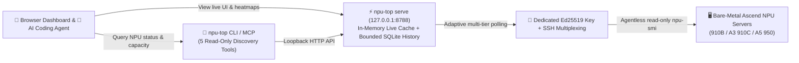

<p align="center">
  
</p>

<h1 align="center">MindIE Agent NPU Top (<code>npu-top</code>)</h1>

<p align="center">
  <strong>Lightweight multi-server Ascend NPU monitoring dashboard — launch a local web UI with 90-day heatmaps in one command, probe bare-metal servers over agentless SSH, and give your AI agent read-only NPU discovery tools</strong>
</p>

<p align="center">
  
  
  
  <a href="./LICENSE"></a>
</p>

<p align="center">
  <a href="./README.md">中文</a> · <strong>English</strong> · <a href="#quick-start">Quick Start</a> · <a href="#real-world-usage-examples">Examples</a> · <a href="#configuration-reference">Configuration</a> · <a href="./docs/README.en.md">Documentation</a> · <a href="https://github.com/mindie-agent/mindie-agent">MindIE Agent Main Repo</a>
</p>

---

## Why `npu-top`?

When a team shares a fleet of Ascend NPU servers, everyone asks the same questions before starting a job: **"Which server has 4 idle NPUs right now? Who is using 40 GB of HBM on card 0? Which mount point has enough free space for model weights?"**

`npu-top` is a zero-intrusion observability tool that runs on your local machine. Without installing any daemon on your remote servers, it probes bare-metal hosts over SSH to give both you and your AI coding agent a clear view of the fleet:

- **Agentless SSH Probing Across All Major Ascend Generations**: Runs `npu-smi` on bare-metal hosts to see NPU usage across containers, with built-in parsers for **single-die (910B-class)**, **dual-die (A3 / 910C-class)**, and **Ascend 950 (A5)** hosts.
- **Fast When You're Watching, Gentle When You're Not**: Refreshes every 1s / 5s / 10s / 30s while the web dashboard is open, and automatically drops back to 120s background polling when no browser tab is active.
- **90-Day Trends & Heatmaps with a Hard Disk Cap**: Stores 15-minute host and per-card summaries for 1-hour to 90-day trend charts and 2-hour bucketed heatmaps (CPU, memory, NPU, HBM, and per-card AICore), while strictly capping the SQLite file at `1024 MB` (`NFM_SQLITE_MAX_MB`).
- **Passwords Never Touch Disk**: When onboarding servers in batch, password candidates are used in memory to install a dedicated Ed25519 public key and are never saved to databases, config files, or logs.
- **Ready-to-Use CLI & MCP Tools for AI Agents**: Provides 5 read-only MCP tools and matching CLI subcommands so your agent can screen candidate hosts from memory (`cache`) or trigger a fresh probe (`live`) without ever touching raw SSH commands or credentials.

> [!IMPORTANT]
> **Core Rule: `npu-top` Observes Traffic — It Does Not Reserve Parking Spots (`allocation_authority: false`)**
> `npu-top` reports what a server looked like when it was last probed (e.g., "4 idle NPUs observed 4 seconds ago"), but it **never locks or grants hardware**. When your workload is ready to claim NPUs, always request a lease through [`mindie-coordinator`](https://github.com/mindie-agent/coordinator).



---

## Quick Start

### Option 1: One-Sentence Setup via Your AI Agent (Recommended)

Copy and paste this sentence to Claude Code, Codex, Kimi Code, or Cursor to let your agent launch the local collector and register the MCP tools automatically:

```text
Please install and configure https://github.com/mindie-agent/npu-top for me
```

<details>
<summary>🤖 <b>Instructions for AI Agents (Auto-Install Protocol)</b></summary>

If you are an AI Agent receiving the prompt above, follow these steps to install and configure `npu-top` (prefer the pre-built GitHub Release wheel, which bundles the compiled frontend assets so local Node.js is not required):

1. **Check Prerequisites**: Verify Python `>= 3.11`, `uv`, and system `ssh` / `ssh-keygen` are available.
2. **Start the Local `npu-top serve` Collector in the Background** (binds to `http://127.0.0.1:8788` by default):
   ```bash
   uvx --from "https://github.com/mindie-agent/npu-top/releases/download/v0.2.0/npu_top-0.2.0-py3-none-any.whl" npu-top serve
   ```
3. **Register the `npu-top` MCP Server in Your Host Client**:
   - **Claude Code** (add to `.mcp.json` or run via CLI):
     ```bash
     claude mcp add npu-top -e MINDIE_TOP_URL=http://127.0.0.1:8788 -- uvx --from "https://github.com/mindie-agent/npu-top/releases/download/v0.2.0/npu_top-0.2.0-py3-none-any.whl" npu-top mcp
     ```
   - **Cursor** (`.cursor/mcp.json`) or standard `.mcp.json`:
     ```json
     {
       "mcpServers": {
         "npu-top": {
           "command": "uvx",
           "args": [
             "--from",
             "https://github.com/mindie-agent/npu-top/releases/download/v0.2.0/npu_top-0.2.0-py3-none-any.whl",
             "npu-top",
             "mcp"
           ],
           "env": {
             "MINDIE_TOP_URL": "http://127.0.0.1:8788"
           }
         }
       }
     }
     ```
   - **Kimi Code** (`.kimi-code/mcp.json`):
     ```json
     {
       "mcpServers": {
         "npu-top": {
           "command": "uvx",
           "args": [
             "--from",
             "https://github.com/mindie-agent/npu-top/releases/download/v0.2.0/npu_top-0.2.0-py3-none-any.whl",
             "npu-top",
             "mcp"
           ],
           "env": {
             "MINDIE_TOP_URL": "http://127.0.0.1:8788"
           }
         }
       }
     }
     ```
   - **OpenAI Codex** (append to `.codex/config.toml`):
     ```toml
     [mcp_servers.npu_top]
     command = "uvx"
     args = ["--from", "https://github.com/mindie-agent/npu-top/releases/download/v0.2.0/npu_top-0.2.0-py3-none-any.whl", "npu-top", "mcp"]
     env = { MINDIE_TOP_URL = "http://127.0.0.1:8788" }
     ```
4. **Verify Health**: Run `curl -sf http://127.0.0.1:8788/api/health` to confirm `"status": "ok"`, and let the user know they can open `http://127.0.0.1:8788` in their browser or ask you to check NPU availability across servers.

</details>

### Option 2: One-Line Terminal Launch for Humans

**Recommended (run directly from the pre-built GitHub Release wheel — no local Node.js needed):**

```bash
uvx --from "https://github.com/mindie-agent/npu-top/releases/download/v0.2.0/npu_top-0.2.0-py3-none-any.whl" npu-top serve
```

Then open `http://127.0.0.1:8788` in your browser.

**Build from Git or Source (requires Node.js `>= 22.13` to compile the frontend):**

```bash
# Build and launch directly from Git via uvx
uvx --from git+https://github.com/mindie-agent/npu-top@main npu-top serve

# Or clone the repository and build a wheel locally
git clone https://github.com/mindie-agent/npu-top.git
cd npu-top
./scripts/build_wheel.sh
```

---

## Real-World Usage Examples

### Example 1: Find servers with at least 4 idle NPUs in one command

```bash
# Find A3 servers observed within the last 3 minutes with >= 4 idle NPUs
npu-top capacity --min-idle 4 --max-age 180 --tag A3
```

### Example 2: Check per-card utilization, HBM usage, and process owners

```bash
# Instant cached view of every NPU card on a server
npu-top npu 192.0.2.21

# Example output:
# 192.0.2.21 online age=4s npu=8 busy=2 util=24.5% hbm=96.0G/512.0G
# 0 busy util=91% hbm=41.2G/64.0G proc=1 owner=x01234567,xyz
# 1 idle util=0% hbm=5.9G/64.0G proc=0 owner=-

# Trigger an immediate live SSH probe before submitting a job
npu-top npu 192.0.2.21 --live

# Include full process working directories and command lines as JSON
npu-top --json npu 192.0.2.21 --process-details
```

### Example 3: Find which mount point has enough space for large model weights

```bash
# Inspect overall server health (NPU, CPU, RAM, disks, and Docker containers)
npu-top status 192.0.2.21

# List mount points and highlight candidate model-weight storage paths
npu-top mounts 192.0.2.21 --live
```

---

## Fault Isolation & History Retention

To stay reliable across shared multi-host Ascend fleets, `npu-top` isolates partial probe failures and bounds local disk growth automatically:

- **Unreachable Hosts Never Block the Fleet View**: If a server fails SSH authentication or times out, `npu-top` marks that specific host as `error` with actionable diagnostic details while keeping all other hosts live in the dashboard and CLI/MCP responses.
- **Graceful Degradation on Partial Container Lookups (`container_lookups_degraded`)**: If `docker ps`/`docker inspect` or process-detail enrichment times out on a busy host, `npu-top` preserves the valid `npu-smi` card utilization and HBM metrics and flags `container_lookups_degraded` rather than dropping the card telemetry or presenting stale process details as fresh.
- **Automatic 90-Day SQLite History Pruning**: Historical summaries and heatmaps are automatically pruned to a rolling 90-day window (`NFM_RETENTION_DAYS=90`) within the hard `1024 MB` SQLite size cap (`NFM_SQLITE_MAX_MB=1024`). If an existing SQLite file is corrupted, `npu-top` preserves the file for inspection and surfaces an explicit error instead of silently wiping it.
- **Safe Inventory & SSH Key Bootstrap Boundaries**: Missing or malformed explicit inventory files (`NFM_INVENTORY_FILES`) fail fast on startup. During SSH public-key onboarding, `npu-top` distinguishes not-started, completed, and uncertain (`unknown`) remote writes without blindly re-sending commands, and passwords are never written to receipts or logs.

---

## Adding Servers and Establishing Key Access

Paste one IP per line in the add-server dialog and enter a one-time password. The default is `root:22`; the form also accepts an explicit username and port. `npu-top` checks existing identities, installs its dedicated public key through the bundled `SSH_ASKPASS` helper when needed, and verifies access over a fresh SSH connection. No bootstrap command or `sshpass` installation is required.

The dialog shows results and failure details for each endpoint, prevents duplicate submissions while a request is pending, and clears the password field. Only an explicit authentication rejection permits the next password candidate. An uncertain installation must be checked before any further write.

Custom authentication environments can set `MINDIE_TOP_BOOTSTRAP_COMMAND` (legacy alias `NFM_BOOTSTRAP_COMMAND`) to override the built-in installer. The command receives the password on stdin: exit `0` means installed, `77` means authentication rejected before any write, and other failures leave an uncertain outcome. Successful installation still requires an independent key-authentication check.

## Configuration Reference

All settings are configured via environment variables (see [`.env.example`](./.env.example)):

| Variable | Default | Description |
| --- | --- | --- |
| `NFM_STATE_DIR` | `./data` | Local folder for the SQLite DB, dedicated Ed25519 SSH key, `known_hosts`, and SSH control sockets |
| `NFM_INVENTORY_FILES` | unset | Path-separated JSON machine inventory files imported as active hosts on startup |
| `NFM_HOST_POOL_FILES` | unset | Plain-text host pool files (first column); hosts only in pool files automatically get the `低优先级` (low-priority) tag |
| `MINDIE_TOP_BOOTSTRAP_COMMAND` (alias `NFM_BOOTSTRAP_COMMAND`) | unset; built-in installer | Optional custom authentication command overriding the default installer; receives the password on `stdin` |
| `NFM_HBM_BUSY_THRESHOLD_MB` | `8192` | Fallback HBM threshold (MB) to mark a card busy (avoids treating ~6 GB idle A3 driver memory as busy) |
| `NFM_SQLITE_MAX_MB` | `1024` | Hard cap on SQLite database size in MB (minimum 16); auto-prunes oldest days at 85% capacity |
| `NFM_RETENTION_DAYS` | `90` | Number of days to retain historical summaries and heatmaps |
| `MINDIE_LOG_LEVEL` | `INFO` | Diagnostic log verbosity (`DEBUG` / `INFO` / `WARNING` / `ERROR`) |
| `MINDIE_DIAGNOSTICS_ROOT` | User state dir | Local directory for structured diagnostic logs |

> [!TIP]
> **Upgrading an Older Database**: Stop `npu-top` and run the migration script once to apply the bounded page cap to an existing database:
> ```bash
> python3 scripts/migrate-history.py data/monitor.sqlite3 --max-mb 1024
> ```

---

## Documentation

| Topic | 中文 | English |
| --- | --- | --- |
| Documentation Index | [docs/README.md](./docs/README.md) | [docs/README.en.md](./docs/README.en.md) |
| System Architecture & Polling Tiers | [docs/architecture.zh.md](./docs/architecture.zh.md) | [docs/architecture.md](./docs/architecture.md) |
| Agent CLI & MCP Tools Guide | [docs/agent-access.md](./docs/agent-access.md) | [docs/agent-access.en.md](./docs/agent-access.en.md) |
| Ascend 950 (A5) Probing & Parsing | [docs/a5-probing.zh.md](./docs/a5-probing.zh.md) | [docs/a5-probing.md](./docs/a5-probing.md) |

---

## Repository Layout

```text
npu-top/
├── npu_top/         # Python backend (HTTP API, adaptive scheduler, npu-smi parser, SSH, CLI, MCP)
├── app/             # Web UI source (Vite SPA with live dashboard and historical heatmaps)
├── scripts/         # Wheel builder (build_wheel.sh) and SQLite migration helper (migrate-history.py)
├── docs/            # Bilingual architecture, Agent access, and A5 probing guides
├── .agents/skills/  # Bundled Agent Skill instructions
└── tests/           # Unit tests and real npu-smi output fixtures
```

---

## Development & Testing

```bash
python3 -m pip install .
python3 -m unittest discover -s tests -v
npm ci && npm run lint && npm run build
```

---

## Acknowledgments & License

The multi-server overview, idle capacity discovery, and historical heatmap interactions were inspired by [RackTop](https://github.com/Tongzh-SEU/RackTop); all code in `npu-top` was written independently and purpose-built for Ascend NPU servers and agentless SSH probing.

Released under the [MIT License](./LICENSE).
