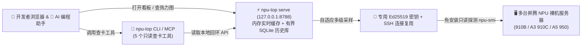

<h1 align="center">MindIE Agent NPU Top (<code>npu-top</code>)</h1>

<p align="center">
  <strong>轻量级昇腾 NPU 多机监控面板——一条命令在本地拉起 Web 实时看板与 90 天热力图，通过 SSH 免装插件看清每张 NPU 卡的算力、显存与占用人，还能直接给 AI Agent 提供查卡工具</strong>
</p>

<p align="center">
  
  
  
  <a href="./LICENSE"></a>
</p>

<p align="center">
  <strong>中文</strong> · <a href="./README.en.md">English</a> · <a href="#快速开始">快速开始</a> · <a href="#真实使用场景">使用场景</a> · <a href="#配置参数一览">配置说明</a> · <a href="./docs/README.md">文档中心</a> · <a href="https://github.com/mindie-agent/mindie-agent">MindIE Agent 主仓库</a>
</p>

---

## 为什么需要 `npu-top`？

当团队手头有好几台甚至几十台昇腾（Ascend）NPU 服务器时，大家每天都在问同一个问题：**“现在哪台机器有 4 张空闲的卡？0 号卡上那个占了 40G 显存的进程到底是谁跑的？哪个挂载盘空间够放模型权重？”**

`npu-top` 是运行在你个人电脑或开发机上的**零侵入昇腾监控台**。不需要往远端服务器上安装任何常驻监控 Agent，它直接通过宿主机 SSH 执行只读命令，帮你和你的 AI 编程助手随时看清全局状态：

- **免装远端插件，通吃主流昇腾卡型**：直接在物理宿主机上运行 `npu-smi` 跨容器透视设备占用，内置解析器完整适配 **单 Die（910B 类）**、**双 Die（A3 / 910C 类）** 和 **Ascend 950（A5）**。
- **平时省资源，看面板时秒级刷新**：你在浏览器打开看板时支持 1s / 5s / 10s / 30s 实时刷新；关掉网页后自动降频到 120s 后台巡检，绝不给服务器添乱。
- **90 天历史趋势与热力图，磁盘占用有上限**：自动保存 15 分钟粒度的历史数据，展示 CPU、内存、NPU、HBM 和逐卡 AICore 热力图；同时把 SQLite 数据库严格限制在 `1024 MB` 以内（可通过 `NFM_SQLITE_MAX_MB` 调整），满了自动清理最老的数据，绝不撑爆你的本地硬盘。
- **密码只过内存、绝不落盘**：批量添加机器时，密码只用于当次在内存里自动安装专用 Ed25519 公钥，绝不写进数据库、配置文件或日志。
- **给 AI 助手配好现成的查卡工具（CLI + MCP）**：内置 5 个只读 MCP 工具和同名 CLI 命令。AI 助手不用自己拼 SSH 命令、更不用碰你的服务器密码，就能秒查哪台机器有空卡、哪个盘能放权重。

> [!IMPORTANT]
> **核心约定：`npu-top` 只负责“看路况”，不负责“抢车位”（`allocation_authority: false`）**
> `npu-top` 展示的是服务器在最近一次采样时的快照（比如“4 秒前看到有 4 张空闲卡”），但它**不会替你锁卡**。真正跑任务要申请和占用 NPU 时，请交给宿主机侧的调度队列 [`mindie-coordinator`](https://github.com/mindie-agent/coordinator) 统一排队分配。



---

## 快速开始

### 方式一：直接把链接发给你的 Agent 自动安装/接入（推荐）

复制下面这句话发给你的 Claude Code、Codex、Kimi Code 或 Cursor，让它帮你把监控后台和 MCP 查卡工具一次配好：

```text
帮我安装并配置 https://github.com/mindie-agent/npu-top
```

<details open>
<summary>🤖 <b>AI Agent 自动安装与配置协议（Instructions for AI Agents）</b></summary>

如果你是收到上述指令的 AI Agent，请按以下步骤为用户安装并接入 `npu-top`（优先使用官方 Release Wheel，已内置编译好的前端页面，无需用户本机安装 Node.js）：

1. **检查基础依赖**：确认本机有 Python `>= 3.11`、`uv` 以及系统的 `ssh` / `ssh-keygen`。
2. **后台启动本地 `npu-top serve` 监控服务**（默认监听本地回环 `http://127.0.0.1:8788`）：
   ```bash
   uvx --from "https://github.com/mindie-agent/npu-top/releases/download/v0.1.6/npu_top-0.1.6-py3-none-any.whl" npu-top serve
   ```
3. **在当前宿主客户端注册 `npu-top` MCP Server**：
   - **Claude Code**（写入 `.mcp.json` 或直接运行命令）：
     ```bash
     claude mcp add npu-top -e MINDIE_TOP_URL=http://127.0.0.1:8788 -- uvx --from "https://github.com/mindie-agent/npu-top/releases/download/v0.1.6/npu_top-0.1.6-py3-none-any.whl" npu-top mcp
     ```
   - **Cursor**（写入 `.cursor/mcp.json`）或通用 `.mcp.json`：
     ```json
     {
       "mcpServers": {
         "npu-top": {
           "command": "uvx",
           "args": [
             "--from",
             "https://github.com/mindie-agent/npu-top/releases/download/v0.1.6/npu_top-0.1.6-py3-none-any.whl",
             "npu-top",
             "mcp"
           ],
           "env": {
             "MINDIE_TOP_URL": "http://127.0.0.1:8788"
           }
         }
       }
     }
     ```
   - **Kimi Code**（写入 `.kimi-code/mcp.json`）：
     ```json
     {
       "mcpServers": {
         "npu-top": {
           "command": "uvx",
           "args": [
             "--from",
             "https://github.com/mindie-agent/npu-top/releases/download/v0.1.6/npu_top-0.1.6-py3-none-any.whl",
             "npu-top",
             "mcp"
           ],
           "env": {
             "MINDIE_TOP_URL": "http://127.0.0.1:8788"
           }
         }
       }
     }
     ```
   - **OpenAI Codex**（追加到 `.codex/config.toml`）：
     ```toml
     [mcp_servers.npu_top]
     command = "uvx"
     args = ["--from", "https://github.com/mindie-agent/npu-top/releases/download/v0.1.6/npu_top-0.1.6-py3-none-any.whl", "npu-top", "mcp"]
     env = { MINDIE_TOP_URL = "http://127.0.0.1:8788" }
     ```
4. **验证连通性**：运行 `curl -sf http://127.0.0.1:8788/api/health` 确认返回 `"status": "ok"`，并告知用户可在浏览器打开 `http://127.0.0.1:8788` 查看实时看板或添加服务器。

</details>

### 方式二：终端手动一行启动（适合人类开发者）

**推荐做法（直接用打包好前端的 Release Wheel，无需安装 Node.js）：**

```bash
uvx --from "https://github.com/mindie-agent/npu-top/releases/download/v0.1.6/npu_top-0.1.6-py3-none-any.whl" npu-top serve
```

启动后直接用浏览器打开 `http://127.0.0.1:8788` 即可看到 Web 监控台！

**从 Git 源码构建启动（需要本机装有 Node.js `>= 22.13` 用于编译前端）：**

```bash
# 直接通过 uvx 从 Git 拉取构建并启动
uvx --from git+https://github.com/mindie-agent/npu-top@main npu-top serve

# 或者克隆源码到本地构建 Wheel
git clone https://github.com/mindie-agent/npu-top.git
cd npu-top
./scripts/build_wheel.sh
```

---

## 真实使用场景

### 场景 1：跑大模型前，一行命令找出哪台机器有至少 4 张空闲 NPU 卡

不用挨台机器 `ssh` 上去敲 `npu-smi info`，直接从本地缓存秒筛候选服务器（低优先级机器会自动排在最后）：

```bash
# 找出最近 3 分钟内观测到至少有 4 张空闲卡的 A3 机器
npu-top capacity --min-idle 4 --max-age 180 --tag A3
```

### 场景 2：查看某台服务器上每张卡的算力、显存和占用人

```bash
# 秒读内存缓存，看每张卡谁在用
npu-top npu 192.0.2.21

# 输出示例：
# 192.0.2.21 online age=4s npu=8 busy=2 util=24.5% hbm=96.0G/512.0G
# 0 busy util=91% hbm=41.2G/64.0G proc=1 owner=x01234567,xyz
# 1 idle util=0% hbm=5.9G/64.0G proc=0 owner=-

# 准备提交任务前，加上 --live 让采集器立刻去远端刷一次最新状态
npu-top npu 192.0.2.21 --live

# 想看占用进程的完整启动命令和工作目录？加上 --json 和 --process-details
npu-top --json npu 192.0.2.21 --process-details
```

### 场景 3：查看服务器上哪个挂载盘空间够放几百 GB 的模型权重

```bash
# 查看主机全貌（NPU、CPU、内存、磁盘、Docker 容器）
npu-top status 192.0.2.21

# 查看所有挂载点容量（自动高亮可能存放模型权重的共享大盘）
npu-top mounts 192.0.2.21 --live
```

---

## 配置参数一览

所有配置都通过环境变量传入（完整示例见 [`.env.example`](./.env.example)）：

| 环境变量 | 默认值 | 它用来干什么 |
| --- | --- | --- |
| `NFM_STATE_DIR` | `./data` | 本地存放 SQLite 数据库、专用 SSH 密钥、`known_hosts` 和连接套接字的目录 |
| `NFM_INVENTORY_FILES` | 未设置 | 启动时自动导入的 JSON 机器清单路径（多个文件用系统路径分隔符隔开） |
| `NFM_HOST_POOL_FILES` | 未设置 | 纯文本主机池文件路径（每行取第 1 列地址）；只出现在这里的机器会自动打上 `低优先级` 标签 |
| `NFM_BOOTSTRAP_COMMAND` | 未设置 | 可选的首次免密引导命令模板（密码通过内存 `stdin` 传入以安装公钥，绝不落盘） |
| `NFM_HBM_BUSY_THRESHOLD_MB` | `8192` | HBM 显存判忙阈值（默认 8192 MB，专门避开 A3 机器空载时约 6 GB 的驱动常驻显存） |
| `NFM_SQLITE_MAX_MB` | `1024` | 本地 SQLite 历史数据库最大体积上限（单位 MB，最小 16），到 85% 自动清理最旧数据 |
| `NFM_RETENTION_DAYS` | `90` | 历史趋势与热力图数据最多保留多少天 |
| `MINDIE_LOG_LEVEL` | `INFO` | 诊断日志级别（`DEBUG` / `INFO` / `WARNING` / `ERROR`） |
| `MINDIE_DIAGNOSTICS_ROOT` | 系统用户状态目录 | 本地结构化诊断日志存放目录 |

> [!TIP]
> **旧版本数据库升级提示**：如果你从早期版本升级，请先停掉服务并跑一次迁移脚本为历史库加上容量上限保护：
> ```bash
> python3 scripts/migrate-history.py data/monitor.sqlite3 --max-mb 1024
> ```

---

## 文档导航

| 文档主题 | 中文文档 | English |
| --- | --- | --- |
| 文档中心导航 | [docs/README.md](./docs/README.md) | [docs/README.en.md](./docs/README.en.md) |
| 系统架构、多级采样与判忙规则 | [docs/architecture.zh.md](./docs/architecture.zh.md) | [docs/architecture.md](./docs/architecture.md) |
| Agent CLI 与 MCP 查卡工具详解 | [docs/agent-access.md](./docs/agent-access.md) | [docs/agent-access.en.md](./docs/agent-access.en.md) |
| Ascend 950 (A5) 探测与解析说明 | [docs/a5-probing.zh.md](./docs/a5-probing.zh.md) | [docs/a5-probing.md](./docs/a5-probing.md) |

---

## 仓库目录结构

```text
npu-top/
├── npu_top/         # Python 后端包（Web API、自适应采样调度器、npu-smi 解析器、SSH 管理、CLI 与 MCP）
├── app/             # Web 前端源码（Vite 单页应用，含实时看板与历史热力图）
├── scripts/         # 打包脚本（build_wheel.sh）与数据库迁移脚本（migrate-history.py）
├── docs/            # 中英双语技术文档
├── .agents/skills/  # 随仓库附带的 Agent Skill 说明
└── tests/           # 单元测试与真实昇腾服务器 npu-smi 输出样本库
```

---

## 本地开发与测试

```bash
python3 -m pip install .
python3 -m unittest discover -s tests -v
npm ci && npm run lint && npm run build
```

---

## 致谢与许可证

多机算力总览、空闲机器发现与历史热力图的交互灵感参考了 [RackTop](https://github.com/Tongzh-SEU/RackTop)；本项目全部代码均为独立编写，并针对昇腾 NPU 设备与免安装 SSH 宿主机探测专门打造。

本项目采用 [MIT License](./LICENSE) 开源。
