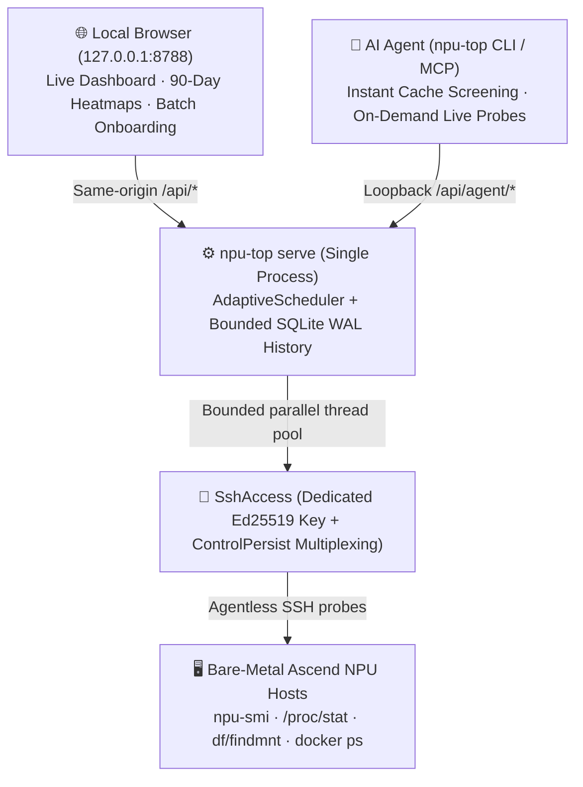

# System Architecture, Polling Tiers & Busy Detection

[中文](./architecture.zh.md) · **English** · [Back to Documentation Index](./README.en.md)

`npu-top` is designed as a lightweight, single-process local monitor that gives you a live web dashboard and 90-day historical heatmaps across multiple Ascend servers while serving instant read-only queries to local AI coding agents.

---

## 1. Host Access & Inventory Merging

Everything that talks to a remote host is wired together in `DeviceAdapter` (`npu_top/device_adapter.py`):

- **Dedicated SSH Key & Isolated State (`SshAccess`)**: Manages a dedicated Ed25519 key pair and an isolated `known_hosts` file inside `NFM_STATE_DIR` without touching your personal `~/.ssh/config`.
- **Bundled `npu-smi` Parser (`npu_smi`)**: Parses `npu-smi info` and `npu-smi info -t usages` outputs directly with comprehensive unit tests covering 910B, A3 (910C), and A5 (950) layouts.
- **Explicit Inventory Files**:
  - `NFM_INVENTORY_FILES`: JSON machine inventory files (`{"machines": [...]}`) providing display aliases and hardware tags.
  - `NFM_HOST_POOL_FILES`: Plain-text host lists (only the first column is read; any adjacent credential columns are ignored, and hosts found only in pool files automatically get the `低优先级` low-priority tag).
  - `npu-top` **never walks parent folders or Git directories to guess machine lists.**
- **Built-in Key Onboarding (`SshAccess`)**: Batch onboarding first checks the monitor key and default SSH identities, then uses the bundled `SSH_ASKPASS` helper with the request's password candidates. No bootstrap command or `sshpass` installation is required. The helper source contains no credentials; the password is passed only in the SSH child process environment. Temporary helpers are removed after success or failure. Host-key verification uses the monitor's `known_hosts`, and key verification opens a fresh SSH connection rather than reusing a prior authenticated session.
- **Optional Installer Override (`ExternalKeyBootstrap`)**: `MINDIE_TOP_BOOTSTRAP_COMMAND` (legacy alias `NFM_BOOTSTRAP_COMMAND`) replaces the built-in password installer when explicitly configured. Passwords arrive on `stdin`. Exit `0` confirms installation; exit `77` means authentication was rejected before any write and permits the next candidate. Other failures remain uncertain and are not replayed. **Passwords are never stored in SQLite tables, config files, CLI flags, helper files, receipts, or logs.**

---

## 2. Why `npu-top` Is Strictly Observation-Only

In a shared Ascend environment, three components have distinct jobs:
1. **Machine Inventory**: Lists which servers exist;
2. **`npu-top`**: Reports what a server looked like when it was last probed (`observed_at`);
3. **Host Coordinator (`mindie-coordinator`)**: The sole authority that grants NPU leases and service ports to workloads.

Because a monitoring snapshot can become outdated the moment another user starts a job, `npu-top` makes its observation-only boundary explicit across every interface:
- Every `/api/agent/*` payload includes an `observation` envelope with `observed_at`, `age_seconds`, `allocation_authority: false`, and a clear notice.
- `/api/agent/capacity` reports `kind: observed_availability`, stamps `observed_at` with the oldest snapshot used to build the shortlist, and reminds callers that idle counts are not reservations.
- Every `/api/` response carries the `X-MindIE-Top-Contract: observation-only` HTTP header, and `/api/health` reports `contract: observation-only`.
- All 5 MCP tool descriptions and the CLI help text end with this same reminder (enforced by `tests/test_agent_cli_mcp.py`).

---

## 3. Adaptive Multi-Tier Polling & How "Busy" Cards Are Detected

- **Fast While You Watch, Quiet When Idle**:
  - While a browser tab is open, `npu-top` polls at the fastest active viewer lease (`1s` / `5s` / `10s` / `30s`);
  - When no browser tab is open, polling drops back to **120 seconds**;
  - Disk mounts (`df` / `findmnt`) and Docker containers (`docker ps`) are cached on a separate **60-second** cadence;
  - CPU usage is computed from consecutive `/proc/stat` counter deltas, so **remote SSH probes never need to `sleep`**.
- **When Is an NPU Card Marked `busy`?**
  An NPU is marked `busy` if any of the following hold at probe time:
  1. The host `npu-smi` process table lists an owning process on that card;
  2. AICore utilization is above `1%`;
  3. HBM usage exceeds `NFM_HBM_BUSY_THRESHOLD_MB` (default `8192 MB`). Why 8 GB? Because idle A3 (910C) cards hold roughly 6 GB of resident driver HBM per card — setting the fallback threshold at 8192 MB catches hidden cross-container memory usage without falsely marking idle A3 cards as busy.
- **No Overlapping Cycles & Cross-Platform SSH**:
  A new polling cycle is scheduled only after the previous cycle finishes, preventing SSH backlog buildup. On Linux and macOS, `ControlPersist` reuses authenticated SSH sockets under a short path; on native Windows, unsupported Unix-domain socket options are omitted automatically, while local state directories (`0700`), SSH keys (`0600`), and atomic `os.replace` file updates avoid extra Windows ACL ceremonies.

---

## 4. SQLite Persistence & Heatmap Aggregation

SQLite runs in WAL mode with history writes throttled to at most once every 30 seconds. The heatmap endpoint uses SQLite JSON functions to group 15-minute summaries and per-device metrics into timezone-aligned **2-hour buckets**, allowing the browser to render server-level and per-NPU 90-day heatmaps without downloading raw sample payloads.
