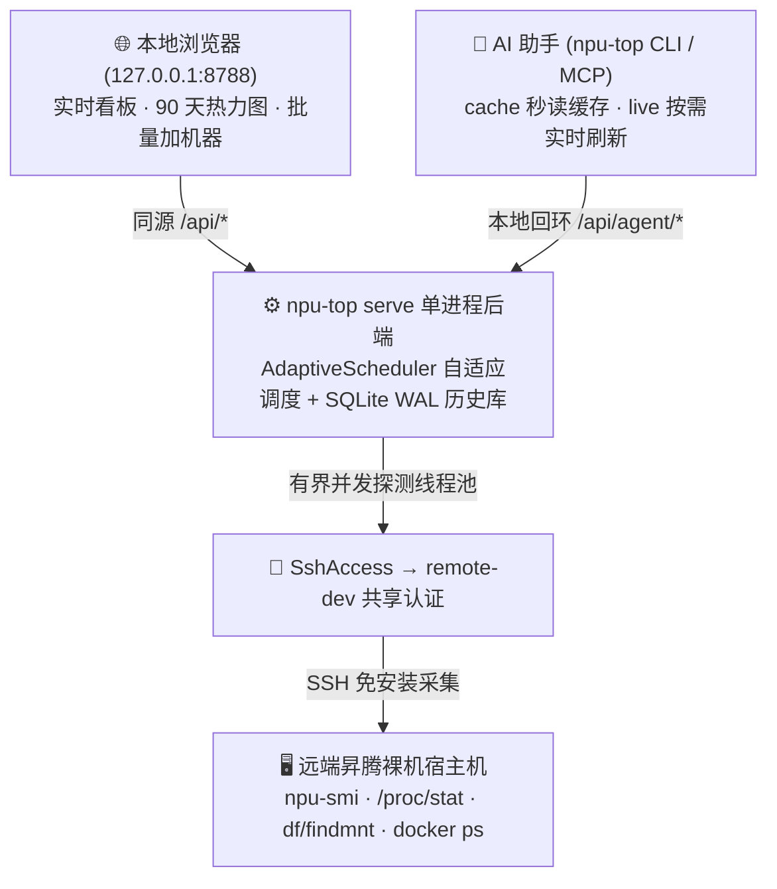

# 系统架构、多级采样与判忙规则

**中文** · [English](./architecture.md) · [返回文档中心](./README.md)

`npu-top` 的设计初衷是用最轻量的单进程服务，让你在本地就能看清多台昇腾服务器的实时负载和 90 天历史趋势，同时给本机的 AI 编程助手提供随叫随到的查卡接口。

---

## 1. 怎么连接服务器和导入机器清单？

所有跟远端服务器打交道的逻辑都集中在 `DeviceAdapter`（`npu_top/device_adapter.py`）里，结构清晰、互不耦合：

- **共享 SSH 认证（`SshAccess`）**：将监控主机转换成 remote-dev endpoint，并复用其 SSH 启动器。监控数据库保存 `auth_ref`；凭据、公钥安装和认证策略统一属于 remote-dev。已有监控密钥文件仍可使用，但不再生成新的独立密钥。
- **内置零依赖解析器（`npu_smi`）**：自带经过完整单元测试验证的 `npu-smi info` 与 `npu-smi info -t usages` 解析器，支持 910B、A3 (910C) 和 A5 (950)。
- **明确的机器清单导入**：
  - `NFM_INVENTORY_FILES`：导入 JSON 格式的常用机器清单（提供机器别名与硬件标签）。
  - `NFM_HOST_POOL_FILES`：导入纯文本主机池列表（只读每行第一列 IP/主机名，忽略后面的密码列；只出现在主机池里的机器会自动打上 `低优先级` 标签）。
  - `npu-top` **绝不会自己去翻你的父目录或 Git 仓库猜机器列表**。
- **统一凭据管理**：批量添加主机时接受已有 `auth_ref`，或将一个密码交由 remote-dev 导入。remote-dev 统一管理本地密码文件，默认路径为 `~/.mindie/ssh/credentials.json`，不需要系统钥匙串解锁。监控台只保存返回的引用。其他机器或用户的引用在当前服务不可解析时明确显示未就绪，不创建第二套凭据；不再遍历候选密码或运行外部公钥引导命令。

---

## 2. 为什么强调“只看状态，不管分卡”（Observation-Only）？

在多人共用的昇腾集群里，通常有三个角色：
1. **机器清单**：声明有哪些服务器存在；
2. **`npu-top` 监控台**：告诉你某台服务器在最近一次探测那一刻（`observed_at`）看起来有几张空卡；
3. **宿主机协调器（`mindie-coordinator`）**：真正给任务发牌、锁卡和分配端口的唯一权威。

因为监控快照随时可能过期（比如你刚看到有空卡，下一秒同事的任务就起上去了），为了防止 AI Agent 把“看到空闲”当成“已经抢到手”，`npu-top` 在所有接口里都加了明确护栏：
- 所有 `/api/agent/*` 返回结果都带有一个 `observation` 信封，明确写着 `"allocation_authority": false` 和采样年龄 `age_seconds`。
- `/api/agent/capacity`（筛选空闲机器）返回的 `observed_at` 取自候选列表里最老的那条快照时间，并提示“空闲卡数不等于设备预留”。
- 所有 HTTP 响应都带有 `X-MindIE-Top-Contract: observation-only` 响应头，`/api/health` 也会返回 `contract: observation-only`。
- 全部 5 个 MCP 工具的描述和 CLI 帮助文本末尾都写明了这一原则（由单元测试 `tests/test_agent_cli_mcp.py` 自动检查保护）。

---

## 3. 自适应多级采样与 NPU 判忙逻辑

- **人在看时刷得快，人走了自动降频**：
  - 当你在浏览器打开看板时，采样频率自动跟着页面设置走（最快支持 1s / 5s / 10s / 30s）；
  - 当所有浏览器页面都关掉后，自动回落到 **120 秒一次**的低频后台巡检；
  - 磁盘挂载（`df` / `findmnt`）和 Docker 容器（`docker ps`）变化慢、开销大，独立按 **60 秒**周期缓存；
  - CPU 利用率直接用连续两次读取 `/proc/stat` 的计数差值计算，**远端探测完全不需要 `sleep` 等待**。
- **一张 NPU 卡怎么才算“忙（`busy`）”？**
  只要满足以下任意一条，这张卡就会被标为 `busy`：
  1. `npu-smi` 进程表里能看到有进程占着这张卡；
  2. 卡的 AICore 利用率超过 `1%`；
  3. 卡的 HBM 显存占用超过了兜底阈值（默认 `8192 MB`）。为什么默认设在 8 GB？因为实测 A3 (910C) 服务器在完全空载时，每张卡的底层驱动也会常驻占用约 6 GB HBM——设成 8192 MB 既能抓出跨容器隐藏的显存占用，又不会把空载的 A3 机器误判成全忙！
- **绝不堆积请求 & 跨平台兼容**：
  上一轮探测完成后才安排下一轮，避免堆积 SSH 进程。采集复用 remote-dev 的跨平台启动器及完整认证环境，并关闭公钥修复；定时采集不会改写远端授权文件。

---

## 4. 本地 SQLite 存储与热力图聚合

本地 SQLite 开启 WAL 模式运行，高频实时快照放在内存里，写入历史库最快每 30 秒一次。热力图接口直接利用 SQLite 内置的 JSON 函数把历史摘要按当前时区切分成 **2 小时一格的时间桶**，浏览器不用下载海量原始采样点就能秒级渲染出整机和单卡 90 天热力图。
